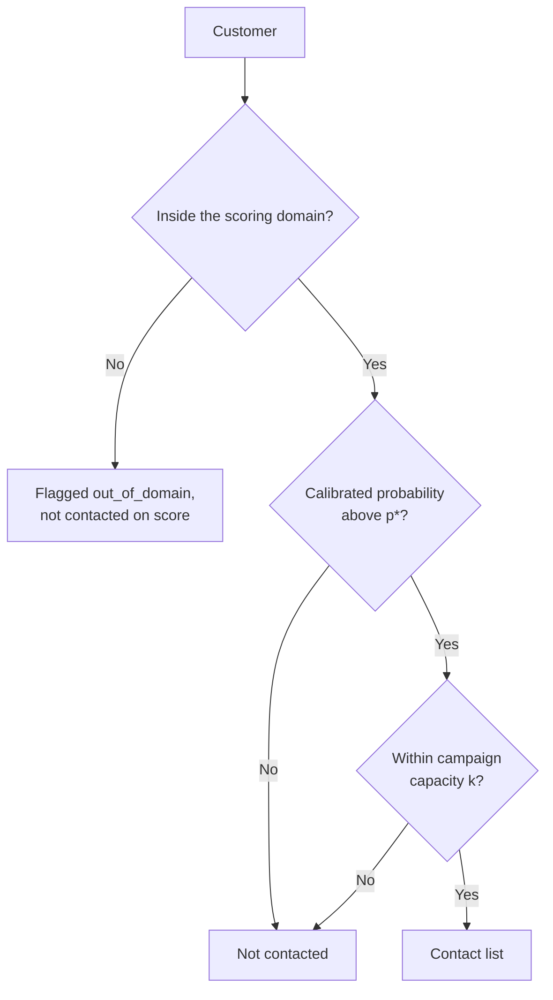
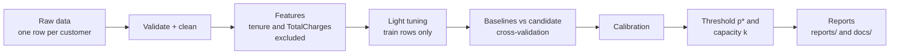

# Telco Churn: who is worth a retention call?

**Estimate who will churn, then decide who is worth contacting, and say honestly how much that is worth.**

[](#business-value-status)
[](DATA.md)
[](LICENSE)
[](#make-targets)
[](#make-targets)

> **In short.** For each customer the pipeline estimates the probability of churn, calibrates it, and picks the customers worth contacting: only those above the break-even threshold who still fit within campaign capacity. You get a **contact list and a conditional business value**, not only a score.

> [!IMPORTANT]
> **Business numbers are scenarios, not forecasts.** They hold only while the inputs in `assumptions.yaml` are true. The key input, `save_rate`, is still an assumption, so every business value is labelled *conditional*.

---

## At a glance

| You give | You get | You decide |
|:--|:--|:--|
| One row per customer (the public IBM Telco file is included) and your business inputs: customer value, contact cost, save rate, capacity. | A calibrated churn probability per customer, the break-even threshold `p*`, a contact list, and one final report with a model card and recommendations. | Whom to contact in a period, and whether the evidence is strong enough to run the campaign. |

## Find your way

| I want to... | Go to |
|:--|:--|
| See it run in a few minutes | [Quick start](#quick-start) |
| Understand what the project does | [Features](#features) |
| Understand how a customer ends up on the contact list | [The contact decision](#the-contact-decision) |
| Read a report without getting lost | [Reading the report](#reading-the-report) |
| Change my business assumptions | [Changing business assumptions](#changing-business-assumptions) |
| Fix a problem | [Troubleshooting](#troubleshooting) |
| Look up a word | [Glossary](#glossary) |

| You are a | Read | Then |
|:--|:--|:--|
| Retention or marketing lead | [User guide](docs/user-guide.md) | You can stop here. |
| Analyst | [Methodology](docs/methodology.md) | Back to the user guide. |
| Developer | [Reference](docs/reference.md) | Dive into `src/`. |

Also available: [Model card](docs/model_card.md), [Recommendations](docs/recommendations.md), [Path A adaptation](docs/adaptation_path_a.md) (what to change when the data has dates).

## Why this exists

A retention campaign has a price, so contacting everyone is as wrong as contacting no one.

| If you contact... | You lose... | It shows up as |
|:--|:--|:--|
| **Too few** | Customers who would have stayed. | Revenue that leaves. |
| **Too many** | Campaign budget on customers who were never leaving. | Cost with no return. |

The balance point is a **break-even probability**: below it, one contact costs more than the value it is expected to save. The project computes it from your inputs and contacts only customers above it.

Then it asks the question many churn projects skip: **does a model-based contact policy beat contacting no one, or contacting at random?**

---

## Features

| | Feature | In one line |
|:-:|:--|:--|
| 🎯 | [Break-even threshold](#the-contact-decision) | Contact only when the expected value is not negative. |
| 🥊 | Fair model contest | Simple baselines against a gradient-boosted candidate, chosen by cross-validation, never by the test set. |
| 🔧 | Light tuning, rule locked | Small grids, scored on training rows only; a change must beat the default by a margin set before the run. |
| 📐 | Calibrated probabilities | Isotonic calibration on a separate block, checked against a tolerance. |
| 🌫️ | Uncertainty on display | Bootstrap intervals on test metrics; small segments are flagged as unreliable. |
| 🔒 | Leakage policy | `tenure` and `TotalCharges` are excluded by policy, and their cost is measured. |
| 📡 | Drift reference | A reference distribution and thresholds for every model feature, ready to score new batches. |
| 🧾 | Strict reporting | Numbers come from a few files only; documents are rendered, not typed. A test enforces it. |
| 🚧 | Safe data handling | Corrupt files are rejected with an error code; synthetic data is always labelled. |

<details>
<summary><strong>More detail on each feature</strong></summary>

- **Fair model contest.** Baselines are the base rate and logistic regression. The candidate is gradient boosting. The winner is the one that scores best in cross-validation on training rows, not the most complex one.
- **Light tuning, rule locked.** The decision rule is hashed into `params.yaml` before the run. If the rule and its lock disagree, training stops. Tuning folds differ from the selection folds.
- **Calibrated probabilities.** If the model says thirty percent, about thirty percent of such customers should churn. Calibration is fitted on its own block, and the test set only checks it.
- **Uncertainty on display.** Test metrics come with a bootstrap interval. Segments below the minimum size are flagged and should not be read.
- **Leakage policy.** The two columns are not proven leaky; the data has no dates to show when they were measured. The ablation (`make ablation`) shows what excluding them costs.
- **Drift reference.** `reports/monitoring.json` covers exactly the model's features. A check fails if the file and the model disagree. Nothing yet runs it on live batches (see [Status](#status-and-open-decisions)).
- **Strict reporting.** Templates contain no numeric literals. Every number in a rendered document must match a value in the source files, and each document carries a source hash so a stale one is detected.
- **Safe data handling.** Validation checks duplicated ids, bad labels, missing columns and more, each with its own code.

</details>

---

## Quick start

**Step 1. Install.**

```bash
make install
```

**Step 2. Run the fast demo on the sample.**

```bash
make all-sample
```

This validates the sample, builds features, trains, computes business value, and renders the documents. The sample is small, so it is for trying things out, not a source of official numbers.

**Step 3. Read the result.**

Open `reports/final_report.md`. Start with the conditional-value box, then follow [Reading the report](#reading-the-report).

<details>
<summary><strong>What should I see after the run?</strong></summary>

- `reports/final_report.md`, `reports/metrics.json`, `reports/roi.json`, `reports/ablation.json`, `reports/monitoring.json`.
- `docs/model_card.md` and `docs/recommendations.md`, rendered from the same numbers.
- Model files under `artifacts/` (generated, not committed).

On the sample, calibration may land outside tolerance because the test set is small. That is reported as it is and is not an error. The official report comes from the full data:

```bash
make all
```

</details>

---

## The contact decision



`p*` comes from customer value, contact cost and `save_rate`. Capacity `k` comes from `assumptions.yaml`. A customer below `p*` is not contacted even when capacity is left.

The project also compares this policy with **no contact** and with **random contact at the same number of contacts**, and reports the `save_rate` at which the campaign just breaks even.

### Business value status

| Status | Meaning | When |
|:--|:--|:--|
| `conditional` | Every business value is a scenario under assumptions. Do not quote it as a forecast. | `save_rate_source` is `assumed` (the current state). |
| `measured` | Business value rests on a `save_rate` from a controlled trial. | After you replace `save_rate` and its source with measured results and run `make all` again. |

The status is stored as `business_status` in `reports/metrics.json` and shown as a box in every document.

---

## Reading the report

Read `reports/final_report.md` in this order.

| Order | Section | The question it answers | Watch for |
|:-:|:--|:--|:--|
| First | **Conditional-value box and data source** | How far can I trust the numbers? | Status still `conditional`. |
| Second | **Selected model** | Which model won, and why? | The choice comes from cross-validation, not the test set. |
| Third | **Model against baselines** | Is it better than the base rate and logistic regression? | Look at the intervals, not only the points. |
| Fourth | **Calibration** | Do probabilities mean what they say? | Calibration error within tolerance. |
| Fifth | **Segments** | Does it work for each customer group? | Read only segments flagged reliable. |
| Sixth | **Contact decision and value** | Who is contacted, and what is it worth? | Compare the break-even `save_rate` with your assumption. |
| Seventh | **Limitations and what is not recommended** | What must I not conclude? | Read before quoting any number. |

> [!TIP]
> Each rendered document ends with a source hash. If it no longer matches the metrics it came from, the document is stale: run `make all` again.

---

## How it works



The split is stratified random: train, calibration and test blocks. The test block is used only to report.

```
[ train: tune, cross-validate, fit ]  [ calibration ]  [ test: report only ]
```

| Step | Command | What it does |
|:--|:--|:--|
| Data | `make data` | Loads and validates the file, records its sha256. |
| Features | `make features` | Builds non-temporal features and the label. |
| Train | `make train` | Tunes, selects, fits, calibrates, writes the drift reference. |
| Monitoring | `make monitoring` | Checks the drift file covers exactly the model's features. |
| Ablation | `make ablation` | Compares with and without the two excluded columns. Diagnostic only. |
| ROI | `make roi` | Computes the business value from the test results. |
| Render | `make render` | Renders the report, model card and recommendations. |

---

## Changing business assumptions

Edit **`assumptions.yaml` only**: customer value, contact cost, `save_rate`, `save_rate_source`, capacity, population. Then run `make all`, so that `p*` and every document are recomputed.

Business numbers are not allowed in `params.yaml` (a test enforces it). Once `save_rate` has been measured in a controlled trial, replace its value and its source. That is the only way the conditional status goes away.

---

## Run reference

### Make targets

| Target | Does |
|:--|:--|
| `make install` | Installs the project with the dashboard and dev extras, at the versions in `constraints.txt`. |
| `make all` | The full pipeline on the full data. |
| `make all-sample` | The fast path on the sample, for local iteration. |
| `make dashboard` | Read-only dashboard: model hash, contact list, banner. |
| `make lint` / `make test` | Ruff and pytest. |
| `make check-p1` to `make check-p6` | Per-part check: lint, that part's tests, its characteristic step, then the handoff manifest. |
| `make clean` | Removes generated output and caches. |

Steps can also be called directly from the project root, for example `python -m src.models.train`. No `PYTHONPATH` setup is needed.

### Where things live

| Path | Contents |
|:--|:--|
| `params.yaml`, `assumptions.yaml` | The only configuration: technical parameters and business inputs. |
| `src/data/`, `src/features/` | Loading, validation, cleaning, feature building, leakage detector. |
| `src/models/` | Split, training, tuning, calibration, evaluation, prediction, targeting, ablation, drift reference. |
| `src/reporting/` | Business value, strict rendering, number tracing, dashboard. |
| `templates/` | One template per rendered document, no numeric literals. |
| `reports/` | Every number of a run, plus the final report. |
| `docs/` | Rendered model card and recommendations, plus the long-form guides. |
| `tests/`, `scripts/`, `handoff/` | Tests (marked by part), check scripts, per-part manifests. |
| `DATA.md`, `SECURITY.md`, `CHANGELOG.md` | Data origin and terms, vulnerability reporting, change history. |

Generated, not committed: `artifacts/` and packaging output.

---

## Troubleshooting

| Symptom | Likely cause | What to do |
|:--|:--|:--|
| `ModuleNotFoundError: No module named 'src'` | Run from outside the project root. | Run from the project root, or use `make`. |
| An `E_MONITOR_...` error from `make monitoring` | A feature or a monitoring setting changed, and the drift file was not rebuilt. | Run `make train` again. |
| An `E_TUNE_LOCK` error when training | The tuning rule and its lock in `params.yaml` disagree. | Revert the rule, or rewrite the lock on purpose with `python -m src.models.tuning --write-lock`. |
| Calibration outside tolerance on the sample | The sample test set is small. | Expected. Use `make all` for the official report. |
| A document looks out of date | It was rendered from older metrics. | Compare the source hash in its footer, then run `make all`. |
| `make dashboard` fails | The dashboard extra is not installed. | Run `make install`. |

## FAQ

**Does the score tell me who can be saved?** No. It estimates churn risk. Whether a contact keeps a customer is `save_rate`, a single assumed value, until a controlled trial measures it.

**Can I quote the business value?** Only as a conditional value, with the assumptions next to it.

**Why are `tenure` and `TotalCharges` excluded?** By policy, not because leakage was shown. The cost of that policy is measured in the ablation and reported. Keeping or including them is the project owner's decision.

**Why does this README show no results?** Numbers live only in the source files and in `reports/`, so documentation cannot drift away from a run.

---

## Problem

- **Domain and relationship.** A subscription telecom service. The relationship is mixed: month-to-month customers (effectively non-contract) and customers on one-year or two-year contracts.
- **Churn definition and window.** Churn is `Churn = Yes` in the file. The data has one row per customer and no dates, so the prediction window is undefined and the project uses a non-temporal variant (see `docs/adaptation_path_a.md`).
- **Population at risk.** All rows in the file, because churn status before the snapshot is not observed.
- **Decision that depends on the score.** Customers whose calibrated `p_churn` is above the break-even threshold `p*` and who rank within campaign capacity `k` are contacted. Capacity and population per period are in `assumptions.yaml`.
- **CLV, intervention cost, save_rate.** All come from `assumptions.yaml`. While `save_rate_source = assumed`, all business value is conditional.

## Glossary

| Term | Meaning |
|:--|:--|
| **Churn** | A customer with `Churn = Yes` in the file. There is no time window. |
| **p_churn** | The calibrated probability that a customer churns. |
| **p\*** | Break-even threshold: the lowest probability at which one contact is worth its cost. |
| **Capacity k** | The most contacts the campaign can make in a period. |
| **Baseline** | A simple reference model: the base rate, or logistic regression. |
| **Candidate** | Gradient boosting, which must beat the baselines to be chosen. |
| **Calibration** | Adjusting probabilities so that stated risk matches observed churn. |
| **save_rate** | The chance that a contacted churner is retained. Currently an assumption. |
| **Conditional value** | A business figure that holds only under the stated assumptions. |
| **Scoring domain** | Customers with enough tenure to score; others are flagged `out_of_domain`. |
| **Ablation** | Re-running with and without the excluded columns to measure their effect. |

---

## Limitations

Every business result is conditional. Read this before quoting any figure.

- `tenure` and `TotalCharges` are excluded by policy, not because leakage was demonstrated. The detector does not flag them, and the data has no dates to show when they were measured. Excluding them costs accuracy, and the ablation measures how much.
- There is no time axis, so there is no temporal validation, and performance on future customers is untested. Temporal mode exists for data with a date column (`schema.snapshot_column`); `docs/adaptation_path_a.md` explains how to switch it on.
- `save_rate` is an assumption and the same for every customer. The score is a risk estimate, not an intervention effect. An uplift model is separate work.
- Test-set results must not be multiplied up to the whole population; the extrapolation uncertainty has not been quantified.
- Customers below the minimum tenure are flagged `out_of_domain` and must not enter the contact list on score alone.
- The split is stratified random, not temporal.
- Recommendations are rendered from a template by design; there is no automatic recommendation branch.

## Status and open decisions

The pipeline, tests and documents run end to end. What remains depends on data and field work, not on code.

- **No date column.** The Telco file has no dates, so temporal mode cannot be used on it.
- **Open decision: `tenure` and `TotalCharges`.** The default is `exclude`, with a measured cost (see `reports/ablation.json` and the section on excluded columns in `reports/final_report.md`). The options: keep `exclude` and report its cost; include them with the risk stated; or wait for dated data and test whether the values are known at prediction time. This is the project owner's decision; none has been applied beyond the default.
- **`save_rate` is still an assumption.** It becomes `measured` only after a controlled trial supplies it. Then replace `save_rate` and `save_rate_source` in `assumptions.yaml` and run `make all`.
- **Uplift model is separate work.** The controlled trial above would also produce the data such a model needs.
- **Drift monitoring is not yet in operation.** The reference, thresholds and `monitoring.assess` exist. Nothing yet runs the comparison on real scoring batches, keeps a history, or alerts anyone, and the thresholds are conventional values, not tuned on this data.
- **Optional extensions.** A wider or adaptive tuning search (the grids are deliberately small), and more candidate models in `models.candidates`.

## License

The source code, templates, tests and documentation are released under the MIT License (see `LICENSE`). The license does not extend to the data: the IBM Telco dataset in `data/raw/` and the files derived from it keep their own terms, and no explicit license for them was found in IBM's published material. The source, checksum and list of derived files are in `DATA.md`; check them before redistributing.

Data attribution: the IBM Telco Customer Churn sample dataset, published by IBM and available from `https://github.com/IBM/telco-customer-churn-on-icp4d`.
